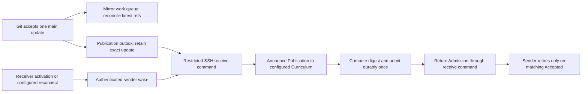

# Git publication delivery

One accepted Git update serves two receivers. The mirror queues a repository to reconcile its current refs. The publication outbox holds exact updates and retires each one only when Curriculum accepts its own digest. The two queues retain different things.

```ethos sketch
Types
[ RepositoryName.String
  ReferenceName.String
  PublicationStream.{ RepositoryName ReferenceName }
  ReceiverHost.String
  OutboxDirectory.String
  PublicationRoute.{ ReceiverHost Vector<PublicationStream> OutboxDirectory }
  ObjectId.String
  Publication.{ PublicationStream Old.ObjectId New.ObjectId }
  PublicationDigest.String
  Announcement.[ PublicationReceived.Publication ]
  Refusal.[ Untrusted Invalid Unavailable ]
  Admission.[ Accepted.PublicationDigest Refused.Refusal ] ]
```



The outbox and Curriculum admission cover the handoff’s two durable states. The receive command forwards the publication and returns the consumer’s admission; it holds no third copy. A refusal, unreachable consumer or lost reply leaves the sender's record for replay. The wake command signals delivery through its exit status and carries no reply payload.

Deployment supplies the receiver host, stream selectors and outbox directory. The landed transport accepts a configurable receiver and repository list and still fixes the ref and outbox path; the route configuration and the sender’s network-return event are separate changes. No host wiring is part of this release.

**Proof:** The targeted Nix check exercises Git admission, transport failures and replay; `ssh_witness.py` exercises authenticated storage and wake across a loopback listener; `curriculum_witness.py` exercises the real Curriculum binary’s refusal, durable admission and deduplication.
