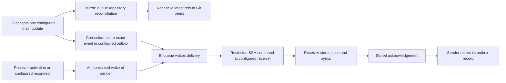

# Git publication delivery

An accepted update to a configured main stream is one Git event with two receivers. The mirror reconciles a repository to its latest refs: repeated pushes can share one repository-keyed work item, because mirroring reads the current refs when it runs. Curriculum consumes the exact repository, ref, old and new from each update and acknowledges durable storage by event digest. The mirror work queue and the publication outbox stay separate because they retain different things: pending reconciliation and exact events, respectively. Giving mirror jobs the publication outbox’s per-event retirement rule would change the mirror’s contract.

```ethos
Types
[ RepositoryName.String
  ReferenceName.String
  PublicationStream.{ RepositoryName ReferenceName }
  ReceiverHost.String
  OutboxDirectory.String
  PublicationRoute.{ ReceiverHost Vector<PublicationStream> OutboxDirectory }
  OldObjectId.String
  NewObjectId.String
  Publication.{ RepositoryName ReferenceName OldObjectId NewObjectId }
  PublicationDigest.String
  Reply.[ Stored.PublicationDigest Ready ] ]
```



Deployment supplies the receiver host, the repository/ref streams and the outbox directory. The event’s canonical Datom determines its digest. Failure or a lost acknowledgement leaves the event in the outbox; replay returns the same receipt. Receiver activation, SSH service restart and a configured reconnect target wake delivery. The receipt attests storage; Curriculum separately validates ancestry and publishes a coherent skill-and-role generation.

**Proof and remaining work:** The isolated prototype proves a real Git fast-forward, filtering, durable storage, lost-acknowledgement recovery and reconnect replay in `checks.x86_64-linux.git-publication-delivery`. The OpenSSH loopback witness in `ssh_witness.py` proves restricted storage and wake using throwaway keys. The prototype takes a configurable receiver and repository list; it still fixes the ref and the outbox path. Expose both through `PublicationRoute` configuration before activation.
