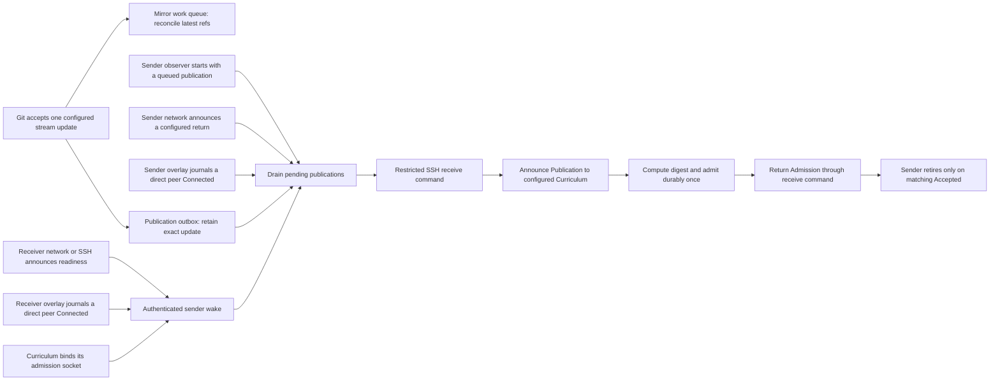

# Git publication delivery

One accepted Git update serves two receivers. The mirror queues a repository to reconcile its current refs. The publication outbox holds exact updates and retires each one only when Curriculum accepts its own digest. The two queues retain different things.

```ethos sketch
Types
[ RepositoryName.String
  ReferenceName.String
  PublicationStream.{ RepositoryName ReferenceName }
  ReceiverHost.String
  OutboxDirectory.String
  PublicationRoute.{ ReceiverHost Vector<PublicationStream> OutboxDirectory }
  ObjectId.String
  Publication.{ PublicationStream Old.ObjectId New.ObjectId }
  PublicationDigest.String
  Announcement.[ PublicationReceived.Publication ]
  Refusal.[ Untrusted Invalid Unavailable ]
  Admission.[ Accepted.PublicationDigest Refused.Refusal ] ]
```



The outbox and Curriculum admission cover the handoff’s two durable states. The receive command forwards the publication and returns the consumer’s admission; it holds no third copy. A refusal, unreachable consumer or lost reply leaves the sender's record for replay. The wake command marks pending delivery and returns through its exit status.

Deployment sets the receiver through `sender.peer`, sets the exact repository/ref pairs through `streams` at both endpoints, and sets one durable `sender.outboxDirectory`. On adoption, declare the previously selected repositories with `refs/heads/main` and keep the existing outbox path so pending records remain visible. Change a stream or outbox path only after its pending records are delivered or explicitly moved. Enable additional streams after both endpoints and Curriculum support them.

The SSH record stays in its flat canonical form and its digest is unchanged. The local announcement carries the nested stream; the receiver checks the exact configured pair before forwarding it. Curriculum checks the publication and derives its digest, then projection decides whether to use the admitted event.

The sender observer wakes the drain once on start if a publication is queued. Both network observers then act on Linux link and route notifications for the configured peer path. The receiver also wakes when its SSH service announces readiness or its Curriculum listener binds. A network owner can announce additional returns by starting a configured target, including a recovery invisible to the local route. The Connected observers follow new entries from the configured journal unit and message pattern; Yggdrasil's log level is also configured. Each role marks its existing one-attempt service; the configured SSH command budget covers path formation. A return strictly between peers of neither endpoint has no Connected at either end; the record waits for the next wake. The patched Yggdrasil package is shared by every host; this release does not switch them.

**Proof:** The targeted Nix check exercises exact Git stream selection, the configured outbox, transport failures and replay on sender startup; `ssh_witness.py` exercises authenticated storage and wake across a loopback listener; `curriculum_witness.py` exercises the real Curriculum binary’s refusal, non-main admission with SHA-256 Git IDs, durable deduplication, and replay of a main record produced by the previous sender.
