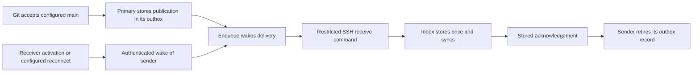

# Git publication delivery

A configured primary Git server sends accepted main updates for the three authored repositories to one configured receiver. For ev4y, that receiver is Ouranos. CriomOS contains no host or belief repository names. A store acknowledgement attests delivery only; Curriculum will separately validate ancestry and publish a coherent skill-and-role generation.

```ethos
Types
[ RepositoryName.String
  ReferenceName.String
  OldObjectId.String
  NewObjectId.String
  Publication.{ RepositoryName ReferenceName OldObjectId NewObjectId }
  PublicationDigest.String
  Reply.[ Stored.PublicationDigest Ready ] ]
```



Publication identity is a digest of the canonical Datom. A failed call or lost acknowledgement leaves the record queued; receiver replay returns the same receipt. The mirror queue remains separate. A receiver that returns after a network-only outage needs an explicit reconnect event from its deployment; receiver activation and SSH service restart already issue the wake. Both roles are opt-in; no credential or host configuration is included.

**Proof:** `checks.x86_64-linux.git-publication-delivery` evaluates the inactive and configured module, checks both forced-command key declarations, and exercises a real scratch Git fast-forward, filtering, durable inbox, lost acknowledgement, and reconnect-driven replay. The peer simulator controls disconnect and acknowledgement loss; it does not attest a live SSH daemon or host deployment.
